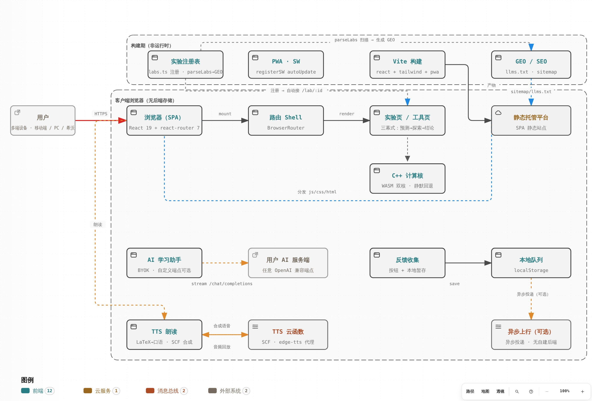
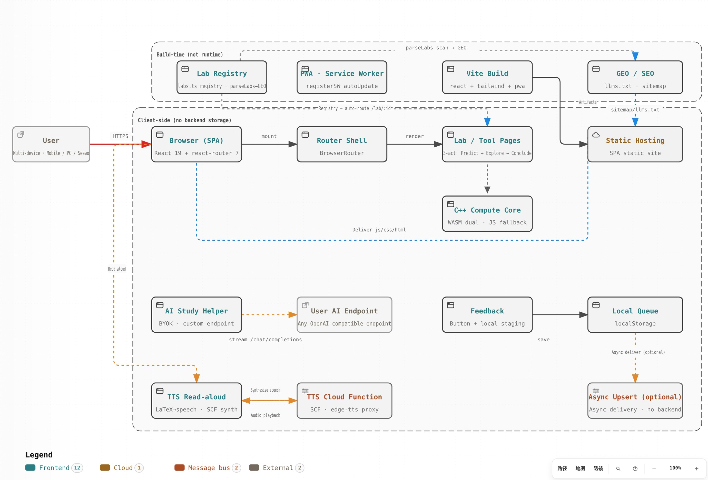

<div align="center">

# 数理化数字实验室

**STEM Digital Lab**

面向初中 7–9 年级课程标准的交互式科学探究与数值建模工作台

<p>
  <a href="LICENSE"></a>
  
  
  
  
</p>

<p>
  <a href="https://stem.irky.dev"><b>▶ 在线体验 (stem.irky.dev)</b></a>
  <span>&nbsp;·&nbsp;</span>
  <a href="#实验与工具清单">实验矩阵</a>
  <span>&nbsp;·&nbsp;</span>
  <a href="#计算引擎">架构机理</a>
  <span>&nbsp;·&nbsp;</span>
  <a href="#快速开始">本地构建</a>
  <span>&nbsp;·&nbsp;</span>
  <a href="#english">English</a>
</p>

<table align="center">
  <thead>
    <tr><th align="center">在线访问 &nbsp;·&nbsp; Visit</th><th align="center">介绍视频 &nbsp;·&nbsp; Intro video</th></tr>
  </thead>
  <tbody>
    <tr>
      <td align="center"></td>
      <td align="center"></td>
    </tr>
  </tbody>
</table>

</div>

| 课程与探究体系 | 数值计算底座 | 工程与交付标准 |
| :--- | :--- | :--- |
| **15 个交互实验 + 6 个工具**<br>覆盖 7–9 年级数理化核心课标 · 三幕式探究 | **C++17 单文件 WASM 求解核**<br>公式核 + 电路求解核 · TS 静默回退与数值对拍 | **纯前端 · 无后端 · 可离线安装**<br>GB/T 4728 国标图形符号 · 735 项单测门禁 |

无需登录 · 中英双语 · 深浅主题 · 电路图 / 仿真图双模视图 · 电学工作台配色过 WCAG AA 对比度

<!-- Hero 区硬指标的口径来源（改动前必须重新实测）：
     15 实验 + 6 工具 ← src/lib/labs.ts 注册表（15 个 kind:'lab' + 1 个 kind:'tool' + 5 个固定路由查表工具，smoke 计数守卫会核对）
     735 passed     ← npm test 实测（46 条测试命令的 Results 汇总；golden 436 条快照单独统计、不计入。
                      新增用例须同步徽章 / 中英正文 / 三栏表 / 本行，tools/check-readme-stats.mjs 会与实测比对）
     C++17 / WASM   ← cpp/ + src/wasm/{stemCore,circuitBench}.js（-std=c++17 · SINGLE_FILE · 双核）
     React 19 / TS  ← package.json（react ^19.0.1 · typescript ^5.9.3）
     GB/T 4728      ← 《电气简图用图形符号》国标族，电路图线稿按国标绘制（render/schematic.tsx）
     WCAG AA        ← 电学工作台配色令牌对比度实测（仅此范围，勿扩大为全站声明）
     徽章视觉        ← labelColor=18181b 统一深炭灰底，值色只做低饱和区分，禁用高饱和撞色
     首屏禁用 Emoji   ← 与站内 UI 同一纪律（正文既有条目另行处理） -->

---

## 中文说明

- [简介](#简介)
- [实验与工具清单](#实验与工具清单)
- [路线图（探索中）](#路线图探索中)
- [运行架构](#运行架构)
- [快速开始](#快速开始)
- [三幕式探究](#三幕式探究)
- [元素周期表工具](#元素周期表工具)
- [AI 学习助手](#ai-学习助手)
- [每日科学](#每日科学)
- [计算引擎](#计算引擎)
- [项目结构](#项目结构)
- [反馈](#反馈)
- [许可](#许可)
- [免责条款](#免责条款)

### 简介

数理化数字实验室是一个**无需登录**的初中 STEM 探究空间，每个实验遵循**三幕式探究**（预测 → 探索 → 结论），鼓励学生先猜想、再操作、后归纳，而非被动跟随固定步骤。

- **中英双语**：右上角一键切换
- **深浅主题**：默认浅色，适合希沃 / 投影大屏
- **多端响应式**：手机 / 平板 / PC / 希沃大屏
- **随机探索**：首页一键随机进入实验或工具
- **15 个交互实验 + 6 个工具**：电学工作台（自由画布搭电路 · 电路图 / 仿真图双视图 · 读表与元件状态监控）、化学式与化合价（化合价速查 · 十字交叉生成 · 由式反推 · 六类练习）、元素周期表（118 元素 · 实物照片 · 读音）、物理常量速查、物理公式速查、数学公式速查
- **AI 学习助手**（顶栏入口）：支持数学公式排版、问答历史（本地持久化）、**考考我**AI 出题练习与**回答朗读**（数学公式、化学式按规范读法读出），错题自动汇入错题集、**可导出 A4 复习卷打印**；面板尺寸可自由调整；配置您自己的 AI 服务商 API Key 即可使用，Key 仅存本机、对话直连服务商、本站不记录
- **可离线安装**：安装为应用后离线使用（PWA）
- **每日科学**：首页每天一位科学家的名言、考点速记与小故事
- **使用说明与版本历史**：顶栏内置交互式使用指引（`/guide`）与版本更新日志弹窗，右下角提供快速反馈通道

### 实验与工具清单

**数学** `7-9`　一次函数 · 二次函数 · 反比例函数 · 圆的性质

**物理** `8-9`　欧姆定律 · 串并联电路 · 凸透镜成像 · 浮力 · 杠杆 · 压强 · 滑轮

**化学** `9`　质量守恒定律 · 酸碱中和 · 电解水 · 金属活动性

**工具**　电学工作台（自由画布搭电路 · 电路图 / 仿真图双视图）· 化学式与化合价（价态速查 · 十字交叉生成 · 由式反推 · 六类练习）· 元素周期表（118 元素 · 检索 · 实物照片 · 读音 · 中考跟读）· 物理常量速查 · 物理公式速查 · 数学公式速查

> 15 个实验与 6 个工具页均内置**问 AI**（结合当前页面的启发答疑）与**考考你**（随堂出题、即时判分）双入口。

### 路线图（探索中）

**目录：** [前端内置轻量 Agent 与端侧纯离线推理](#前端内置轻量-agent-与端侧纯离线推理) · [校园学情收集与教学分析对接](#校园学情收集与教学分析对接) · [回到顶部 ↑](#数理化数字实验室)

#### 前端内置轻量 Agent 与端侧纯离线推理

- **离网自愈**：探索通过规则引擎与端侧超轻量模型（WebGPU / Wasm），在完全物理断网环境下依然提供基础的出题、判分与实验启发能力。
- **保护隐私与零算力成本**：充分利用终端本地算力，敏感学习过程数据不出浏览器，没有持续的 API 账单焦虑。
- **可选加载机制**：保持初始安装包轻盈极速，端侧模型权重作为可选的离线扩展按需下载。

#### 校园学情收集与教学分析对接

- **教学偏误透视**：支持可选对接轻量校园服务端，帮助教研组与任课教师归纳班级高频错题分布、易混淆考点与实验高频提问。
- **极简与本地数据安全**：无需复杂账号与密码体系，基于班级代号 / 机位号匿名化流转，不采集任何个人隐私。
- **纯静态底色不妥协**：核心功能始终保持 100% 独立离线可用，学情同步仅作为可插拔的外设通道。

> 两项都在探索中，且都属于**可选接入**：核心功能保持纯静态、无需登录、离网可用；端侧模型权重与校园学情对接都不会成为必需依赖。

[回到顶部 ↑](#数理化数字实验室)

### 运行架构

本项目为**纯前端 SPA**（React 19 + react-router 7 + Vite 6 + TypeScript 5.9 + Tailwind CSS 4 + KaTeX 0.18），**无自建后端与数据库**，数值计算由 **C++17 / WebAssembly 计算核**在端侧完成，发布为静态站点托管（CDN 静态托管）。运行架构如下图所示：

<div align="center">
  
</div>

- **静态托管平台**：承接 Vite 构建产物并分发到 CDN 边缘节点
- **C++ 计算核**：公式求值（欧姆定律、凸透镜、二次函数、反比例、酸碱中和、浮力）与电学工作台的直流求解共用同一份 C++17 源码，经 Emscripten 编成 SINGLE_FILE WASM 在浏览器内按需调用，不新增网络请求；未载入时静默回退 JS 真源，结果由 g++ / WASM / TS 三方对拍保证一致
- **AI 学习助手**（BYOK）：浏览器直连您自己的 AI 服务商（兼容 OpenAI 端点，流式 /chat/completions），Key 仅存本机、本站无记录
- **TTS 朗读**：LaTeX 口语化格式化 → SCF 云函数代理 edge-tts 合成语音并回放
- **预览即可用、可安装**：Service Worker 预缓存应用外壳（含界面等宽字体子集），页面二次打开与断网后仍可运行；也可安装为桌面 / 手机应用
- **离线教学包（可选下载）**：把元素实物照片、读音音频与结构示意图存到本机，无网也能照常上课；断网时本地实验、公式手册与错题复习卷照常可用，AI 助手需联网（若使用本机 / 局域网推理服务则不受影响）
- **反馈收集**：按钮触发 → 本地队列（localStorage）暂存 →（可选）异步上报，无自建后端、离线可存
- **SEO**：构建期生成 sitemap 供搜索引擎抓取

### 快速开始

```bash
npm install        # 安装依赖
npm run dev        # 开发服务器（默认 http://localhost:3000）
npm run build      # 生产构建
npm run preview    # 本地预览构建产物
npm run test       # 运行测试
```

> 局域网访问：开发服务器监听 `0.0.0.0`，启动后其他设备打开 `http://<本机局域网IP>:3000`。
> Node.js 建议使用 nvm 管理的 v24.19.0（npm ≥ 11.10，.npmrc 配置了供应链保护 min-release-age=7）。

### 测试

```bash
npm test           # 运行全部测试（无需任何服务）
```

内置测试套件 **735 项全绿**（46 条测试命令：`src/smoke.test.ts` 171 项 + 其余命令 564 项；另有一个独立脚本 `src/latex-speech.golden.test.ts` 钉住 **436 条逐字快照**，单独统计、不计入 735），秒级完成，**100% 离线**：不启动服务器、不访问网络、不需要数据库或环境变量。默认那些用例只使用 Node 内置模块（`node:assert` / `node:fs`）；三方对拍那组额外调用本机 `g++` 与已入库的 WASM 产物（两者缺失即失败，不降级为两方对拍）。四类断言并存：

- **三方对拍**：同一批公式的 `g++` 原生真值 · WASM 导出 · TS 回退真源逐点比对（10 个导出，相对容差 1e-5，NaN 哨兵必须两边都是 NaN）；
- **行为与数值**：实验注册表、物理与数学真源对拍、公式朗读、本地存储与题目解析；
- **源码级约束**：触控命中区 ≥40px、不引入第三方图表库、界面不出现 Emoji、中英文案必须对称；
- **进程内替身**：涉及请求的用例一律替换 `fetch` 并在 `finally` 中恢复，绝不触发真实请求。

### 三幕式探究

每个实验由 **预测 → 探索 → 结论** 三幕构成，**不设硬性步骤锁**，学生可随时返回任意幕：

1. **预测**：先根据已有知识形成猜想，不急着看答案
2. **探索**：拖动滑块、开关、图形，观察参数变化并记录证据
3. **结论**：根据观察完成结论题，再查看反馈与考点速记

> 教学建议：先让学生独立预测 → 再邀请学生描述证据 → 最后共同完成结论。

### 元素周期表工具

- 118 个元素完整表格，支持检索（符号/中文/英文）
- 点击元素查看详情：基础属性（IUPAC 标准原子量 + 不确定度）、百科故事、实物照片（可放大）
- 中文读音（内置离线语音包，支持男 / 女声切换）；**中考跟读**：前 20 号元素、金属活动性顺序、常见元素三清单连读，可调次数与间隔
- 原子结构示意图：点击电子层查看该层电子数

### AI 学习助手

- 顶栏入口，辅助解释初中数学（人教版）、物理（苏科版）、化学（人教版）知识，会结合当前页面内容作答
- 使用您自己的 API Key：支持 DeepSeek / 通义千问 / Kimi / 智谱 GLM / 豆包等预设及自定义端点，本站不提供、不代购、不收取任何费用
- 首次使用先阅读并同意使用须知；Key 仅存本机浏览器，对话直连您所选的服务商，本站无后端、不记录任何内容
- 模型列表在连接成功后自动获取；AI 生成内容仅供参考，请以教材和老师讲解为准
- 支持数学公式排版（行内 / 块级 LaTeX），支持问答历史（仅保存在本机浏览器，可随时清除，支持按科目/知识点筛选），面板尺寸可自由调整（右缘拖宽、右下角斜拉），底部显示当前模型与 token 用量估算，设置页可查看累计 token 用量与按日明细
- 点击页面「问 AI」按钮提问，回答末尾会推荐 3 个可继续点击了解的问题并支持「换一批」
- 「考考我」可让 AI 基于当前知识点出单选题或填空题（可选单选/填空/混合，支持 AI 辅助判分），作答后即时判分与讲解；不提供自由输入框
- 答错的题自动收集到错题集，提供学情概览（薄弱知识点、错误类型、趋势）与 AI 总结复习建议
- 错题集可**按科目 / 知识点筛选后导出 A4 复习卷**：导出范围即当前筛选的全部错题（忽略每页 8 条的浏览分页），可选排序方式（按知识点分组 / 按时间倒序）、演算留白（紧凑 / 标准 20mm / 宽松 35mm）与是否附答案与解析（勾选后答案在文末独立起页）；**打印前可先按 A4 纸面预览**核对版式，含公式的选项自动改为单列避免挤压；直接连接打印机，或在系统打印窗口中选择「另存为 PDF」导出保存

### 每日科学

- 首页固定板块：每天展示一位科学家的名言、考点速记与小故事，可一键换一条
- 中英双语，小故事可折叠展开

### 计算引擎

- 交互层仍是 React：欧姆定律、凸透镜成像、二次函数、反比例函数、酸碱中和、浮力的数值核共用一份 C++ 实现（`cpp/stem_core.cpp` + 各公式 hpp：`ohm_formula` / `lens_formula` / `math_fn` / `bulb_formula` / `chem_formula` / `mechanics_formula`），经 Emscripten 编译为同一份 WebAssembly（SINGLE_FILE），在浏览器中按需调用，共 10 个标量导出
- 电学工作台另有一份独立的直流求解核（`cpp/circuit_bench_solver.hpp` + `cpp/circuit_bench_core.cpp`）：按节点法求解网表，元件热模型与保险丝判定留在前端；编译 `bash tools/build-wasm-circuit.sh`，产物为 `src/wasm/circuitBench.js`，未载入时自动回退前端求解。工作台的灯泡热积分与弹簧测力计读数也走上面那份公式核（`bulb_temp_step` / `bulb_resistance` / `spring_reading`）
- 已接入实验：欧姆定律（/lab/ohm）、凸透镜成像（/lab/lens）、二次函数（/lab/quadratic）、反比例函数（/lab/inverse）、酸碱中和（/lab/neutralization）、浮力（/lab/buoyancy），公式与页面模型一致——定值电阻 I = U/(R+Rp)，灯泡 I = U/(R + 0.4U + Rp)（γ = 0.4）；像距 v = uf/(u−f)；y = ax² + bx + c；y = k/x（x = 0 为定义域外的 NaN 哨兵）；灯泡 R(T) 与灯丝温度单步积分；滴定 pH（等当点恰好 7）；F示 = max(0, G − ρ液·g·V排)
- 编译：`npm run build:wasm`（需 emsdk / em++），产物为 SINGLE_FILE 的 `src/wasm/stemCore.js`；未配置 em++、编译失败、运行时加载失败或**任一导出缺失**时，自动整颗回退各 JS 真源（`src/labs/physics/ohm-core.ts`、`lens-core.ts`、`bulb-core.ts`、`mechanics-core.ts`、`src/labs/math/quadratic-core.ts`、`inverse-core.ts`、`src/labs/chemistry/titration-core.ts`），实验照常可用
- 六个实验的参数卡与电学工作台的页头徽标会显示当前引擎：「计算引擎：C++ WebAssembly」或「计算引擎：JS 回退」
- 三方对拍：`npm test` 中的 `src/stem-core-ext.test.ts` 用 `g++` 现场编译 `cpp/stem_cli.cpp` 得到原生真值，与 WASM 导出、TS 回退真源三方逐点比对（10 个导出，相对容差 1e-5，NaN 哨兵必须两边都是 NaN）
- 另附两份仅依赖 C++ 标准库的命令行版：`cpp/cli.cpp` 覆盖欧姆公式，`cpp/stem_cli.cpp` 覆盖全部 10 个导出（stdin 协议），均用 `g++` 即可编译，便于离线验证

### 项目结构

```
cpp/                   # C++ 计算核（公式核 / 电学求解器 / 对拍 CLI），编译脚本在 tools/
src/
├── labs/              # 实验组件（math / physics / chemistry）
│   └── physics/circuit-bench/   # 电学工作台（画布 / 渲染 / 求解器 / 状态监控）
├── wasm/              # Emscripten 产物（SINGLE_FILE，随仓库提交）
├── components/
│   ├── lab/           # 共享实验原语（坐标平面/表盘/反馈面板等）
│   │   └── circuit/   # 电路部件（电阻/灯泡/变阻器/电表等 SVG）
│   ├── layout/        # 外壳（Header / Footer）
│   ├── ai/            # AI 学习助手（面板 / 问 AI 按钮）
│   │   ├── panels/    # 四块域名面板（须知 / 设置 / 记录 / 刷题）
│   │   └── hooks/     # 设置域与刷题域 Hook
│   ├── feedback/      # 反馈气泡与面板 / 分享对话框 / 离线教学包
│   ├── share/         # 标题内嵌分享按钮
│   └── ui/            # 通用 UI（科目/实验图标、公式、占位页、应用内下拉）
├── lib/               # 注册表 / 科目 / i18n / 反馈存储 / 元素数据 / 全局状态 / 下拉定位模型
└── pages/             # 首页 / 科目 / 实验 / 周期表 / 常量与公式速查 / 使用说明 / 许可
```

### 反馈

右下角浮动气泡提供**实验反馈**与**项目反馈**，提交后实时推送到开发者（钉钉 / 微信）；离线或网络异常时自动暂存本机，联网后自动补发。无需登录账号。

在 GitHub / Gitee 上提 issue 时，请附**出问题的页面、浏览器与设备、复现步骤**（版本号见顶栏或「版本历史」），有截图更好——缺陷模板已内置这几项；功能建议与使用提问请直接走上面的反馈气泡。

### 许可

本项目基于 **GNU Affero General Public License v3 (AGPL-3.0)** 开源（见 `LICENSE` 文件，站内也可直接查看全文：`/license`）。你可以自由使用、修改与分发，**但任何衍生作品都必须以 AGPL-3.0 开源**（含通过网络提供的服务），并**保留原作者版权声明**，不允许闭源拿走。

界面字体为自托管子集（品牌标题宋体、等宽 JetBrains Mono），均以 **SIL OFL-1.1** 授权，许可全文见 `public/fonts/`；AGPL-3.0 只覆盖本项目自身代码。

### 免责条款

- 本项目为**教学演示与个人探究**参考工具，不构成任何专业意见或承诺。
- 实验数据、公式与交互结果已尽力校对，但**不保证绝对正确**，教学中请以权威教材为准。
- 反馈会发送给开发者；离线时暂存本机，联网后补发。请对保存于本机的内容自行负责。

---

## English

- [Overview](#overview)
- [Labs & Tools](#labs--tools)
- [Roadmap (experimental)](#roadmap-experimental)
- [Running Architecture](#running-architecture)
- [Getting Started](#getting-started)
- [Three-Act Inquiry](#three-act-inquiry)
- [Periodic Table Tool](#periodic-table-tool)
- [AI Assistant](#ai-assistant)
- [Daily Science](#daily-science)
- [Computation engine](#computation-engine)
- [Project Structure](#project-structure)
- [Feedback](#feedback)
- [License](#license)
- [Disclaimer](#disclaimer)

### Overview

**STEM Digital Lab** is a **no-login** middle-school STEM exploration space (Grades 7–9). Live at https://stem.irky.dev. Every lab follows a **three-act inquiry** (Predict → Explore → Conclude) that asks students to guess first, explore freely, then conclude — not to follow fixed step-locks.

- **Bilingual (zh/en)** — switchable from the header
- **Light & dark themes** — light by default for classroom projection
- **Responsive layout** — mobile / tablet / PC / Seewo interactive screen
- **Random explore** — a homepage button jumps into a random lab or tool
- **15 interactive labs + 6 tools** — Circuit Workbench (free canvas · circuit and simulation views · live meters and component status), Chemical Formulas (valence reference, cross-rule builder, solver, six practice types), Periodic Table (118 elements · photos · pronunciation · recite), Physics Constants, Physics Formulas, Math Formulas
- **AI assistant** (header entry) — renders math formulas, keeps Q&A history (stored locally), offers "Quiz me" AI practice and **reads answers aloud** (formulas and chemical names in standard spoken form), with wrong answers collected into a mistake book you can **export as a printable A4 revision sheet**; panel size is freely adjustable; configure your own provider API key for science help — key stays on-device, chats go straight to your provider, nothing is logged
- **Offline install** — installable as an app and usable offline (PWA)
- **Daily Science** — a scientist quote, key-point tip and short story each day on the homepage
- **Guide & Version History** — built-in interactive user guide (`/guide`), release changelog dialog, and a persistent feedback entry

### Labs & Tools

**Math** `7–9`　Linear · Quadratic · Inverse Variation · Circle Properties

**Physics** `8–9`　Ohm's Law · Circuits · Lens · Buoyancy · Levers · Pressure · Pulleys

**Chemistry** `9`　Conservation of Mass · Titration · Electrolysis · Metal Activity

**Tools**　Circuit Workbench (free canvas · circuit and simulation views) · Chemical Formulas (valence reference · cross-rule builder · solver · six practice types) · Periodic Table (118 elements · search · photos · pronunciation · recite) · Physics Constants · Physics Formulas · Math Formulas

> All 15 labs and all 6 tool pages ship two entry points: **Ask AI** (page-aware hints and explanations) and **Quiz me** (on-the-spot questions with instant grading).

### Roadmap (experimental)

**Jump to:** [On-Device Lightweight Agent & Offline Inference](#on-device-lightweight-agent--offline-inference) · [Classroom Telemetry & Pedagogical Insights](#classroom-telemetry--pedagogical-insights) · [Back to top ↑](#数理化数字实验室)

#### On-Device Lightweight Agent & Offline Inference

- **Offline resilience**: Exploring deterministic rule engines and ultra-lightweight client-side models (WebGPU / Wasm) to keep basic quiz generation, grading and experiment hints working even in a fully air-gapped classroom.
- **Privacy & zero compute cost**: Uses the compute already on the device, so interaction data never leaves the browser and there is no ongoing API bill.
- **Modular loading**: The initial install stays small and fast; local model weights ship as an optional offline package downloaded on demand.

#### Classroom Telemetry & Pedagogical Insights

- **Learning diagnostics**: Optional integration with a lightweight school-side service that helps teachers and teaching-research groups spot the most frequent wrong answers, confused concepts and repeated experiment questions in a class.
- **Privacy first**: No account or password system; everything travels under a class code and seat alias, and no personal information is collected.
- **Standalone by default**: The core app stays 100% usable offline; classroom telemetry is only a pluggable peripheral channel.

> Both items are experimental and strictly opt-in: the app stays static, login-free and offline-first, and neither local model weights nor classroom telemetry ever become hard dependencies.

[Back to top ↑](#数理化数字实验室)

### Running Architecture

This is a **pure front-end SPA** (React 19 + react-router 7 + Vite 6 + TypeScript 5.9 + Tailwind CSS 4 + KaTeX 0.18) with **no self-hosted backend or database**; numeric evaluation runs on-device in a **C++17 / WebAssembly compute core**, published as a static site (CDN static hosting). The runtime architecture is shown below:

<div align="center">
  
</div>

- **Static host**: serves the Vite build artifacts from CDN edge nodes
- **C++ compute core**: formula evaluation (Ohm's law, convex lens, quadratic, inverse proportion, titration, buoyancy) and the circuit workbench's DC solve share one C++17 source, compiled by Emscripten into a SINGLE_FILE WASM module invoked on demand in the browser with no extra network request; if it fails to load the JS sources silently take over, and g++ / WASM / TS are kept identical by a three-way parity gate
- **AI assistant** (BYOK): the browser talks directly to your own AI provider (OpenAI-compatible endpoint, streaming /chat/completions); key stays on-device, nothing is logged
- **TTS read-aloud**: LaTeX is formatted for speech → a SCF cloud function proxies edge-tts to synthesize and play back audio
- **Works on reopen, installable**: the Service Worker precaches the app shell (including the monospace UI subset), so a second visit — or a lost connection — still runs; the app can also be installed on desktop or phone
- **Offline teaching pack (opt-in download)**: stores element photos, pronunciation audio and structure diagrams on the device for a fully offline lesson; offline, local labs, formula sheets and the mistake book keep working, while the AI assistant needs a network (a local / LAN inference service still works)
- **Feedback**: button click → local queue (localStorage) → (optional) async report; no self-hosted backend, works offline
- **SEO**: sitemap generated at build time for search engines

### Getting Started

```bash
npm install        # Install dependencies
npm run dev        # Dev server (default http://localhost:3000)
npm run build      # Production build
npm run preview    # Preview the build locally
npm run test       # Run tests
```

> LAN access: the dev server listens on `0.0.0.0`; open `http://<your-LAN-IP>:3000` from other devices.
> Node.js: use nvm-managed v24.19.0 (npm ≥ 11.10; .npmrc enables supply-chain guard min-release-age=7).

### Testing

```bash
npm test           # Run the whole suite (no service required)
```

The built-in suite runs **735 cases, all green** (46 test commands: 171 in `src/smoke.test.ts` plus 564 across the rest; one further standalone script, `src/latex-speech.golden.test.ts`, pins **436 verbatim snapshots** and is counted separately), in seconds and is **100% offline**: no server, no network, no database, no environment variables. The default cases use only Node built-ins (`node:assert` / `node:fs`); the three-way parity group additionally shells out to the local `g++` and imports the checked-in WASM artifact (missing either one fails the run rather than degrading to a two-way check). Four kinds of checks live side by side:

- **Three-way parity**: the same formulas checked point by point across `g++` native truth, the WASM exports, and the TS source-of-truth fallbacks (10 exports, 1e-5 relative tolerance, NaN sentinels must be NaN on both sides);
- **Behaviour and numerics**: lab registry, physics/math source-of-truth cross-checks, formula speech, local storage and quiz parsing;
- **Source-level constraints**: touch targets ≥40px, no third-party chart library, no emoji in the UI, zh/en copy must stay symmetric;
- **In-process stand-ins**: every request-related case replaces `fetch` and restores it in `finally`, so no real request ever fires.

### Three-Act Inquiry

Each lab is built from **Predict → Explore → Conclude** with **no hard step-locks**; students can revisit any act at any time:

1. **Predict**: make a guess from prior knowledge before seeing the answer
2. **Explore**: drag sliders, switches, or shapes, observe changes, and record evidence
3. **Conclude**: answer conclusion questions, then check feedback and key points

> Teaching suggestion: let students predict independently, invite them to describe evidence, then complete the conclusion together.

### Periodic Table Tool

- All 118 elements with search (symbol / Chinese / English)
- Tap an element for details: properties (IUPAC standard atomic weights with uncertainty), mini-wiki story, and a real photo (tap to enlarge)
- Chinese pronunciation with built-in offline audio (male / female voice switch); **Recite mode**: first 20 elements, activity series, and common elements, with adjustable repeats and gaps
- Bohr diagram: tap a shell to see its electron count

### AI Assistant

- Header entry that helps explain middle-school math (PEP), physics (Su-Ke) and chemistry (PEP), grounded in the current page
- Use your own API key: presets for DeepSeek / Qwen / Kimi / Zhipu GLM / Doubao plus a custom endpoint; this site provides no key, sells nothing, charges nothing
- Read and accept the terms first; your key stays in your browser, chats go straight to your chosen provider, and this site has no backend and logs nothing
- The model list is fetched after a successful connection; AI output is for reference — trust the textbook and your teacher
- Math formulas are rendered properly (inline / block LaTeX); Q&A history is stored only in your browser, clearable anytime, filterable by subject or topic; panel size is adjustable (drag the right edge, or the corner for both dimensions); the footer shows the current model and estimated token usage, with cumulative usage and per-day details in settings
- Single-turn Q&A: ask via the "Ask AI" button on the page; each answer suggests 3 follow-up questions to tap with a "refresh" option
- "Quiz me" generates single-choice or fill-in questions (choose single-choice/fill-in/mixed, with AI-assisted grading) and scores them instantly with an explanation; no free-text input is provided
- Wrong answers are collected into a mistake book with a learning overview (weak topics, error patterns, trend) and an AI review summary
- The mistake book can be **filtered by subject / topic and exported as an A4 revision sheet**: the export covers every record in the current filter (the 8-per-page browsing view is ignored), with selectable order (by topic / newest first), working space (compact / standard 20mm / roomy 35mm) and an optional answer-and-explanation section on its own page at the end; **preview the real A4 layout before printing**, options containing formulas switch to a single column so long formulas are not squeezed, and you can print straight to a printer or choose "Save as PDF" in the system print dialog to export a file

### Daily Science

- Fixed block on the homepage: a scientist's quote, key-point tips and short story each day, shuffleable
- Bilingual, with a collapsible story

### Computation engine

- The interaction layer stays in React: the Ohm's law, convex-lens, quadratic-function, inverse-variation, acid-base titration and buoyancy labs share one C++ numeric core (`cpp/stem_core.cpp` + per-formula headers: `ohm_formula` / `lens_formula` / `math_fn` / `bulb_formula` / `chem_formula` / `mechanics_formula`), compiled to a single WebAssembly binary (SINGLE_FILE) and invoked on demand in the browser — 10 scalar exports in total
- The circuit workbench has a separate DC solver core (`cpp/circuit_bench_solver.hpp` + `cpp/circuit_bench_core.cpp`): nodal analysis over the netlist, while component heat and fuse behaviour stay in the frontend; build with `bash tools/build-wasm-circuit.sh` into `src/wasm/circuitBench.js`, falling back to the frontend solver when it cannot load. The workbench's bulb heat integration and spring-scale readings also go through the formula core above (`bulb_temp_step` / `bulb_resistance` / `spring_reading`)
- Wired up labs: Ohm's law (/lab/ohm), lens (/lab/lens), quadratic (/lab/quadratic), inverse variation (/lab/inverse), acid-base titration (/lab/neutralization), buoyancy (/lab/buoyancy), with formulas identical to the on-page models: fixed resistor I = U/(R+Rp); bulb I = U/(R + 0.4U + Rp) (γ = 0.4); image distance v = uf/(u−f); y = ax² + bx + c; y = k/x (x = 0 carries a NaN sentinel as an out-of-domain marker); bulb R(T) plus the filament temperature step; titration pH (exactly 7 at equivalence); spring reading = max(0, G − ρ·g·V_displaced)
- Build with `npm run build:wasm` (requires emsdk / em++); the output is a single-file `src/wasm/stemCore.js`. If em++ is absent, the build fails, the runtime load fails, or **any export is missing**, every lab falls back to its JS core (`src/labs/physics/ohm-core.ts`, `lens-core.ts`, `bulb-core.ts`, `mechanics-core.ts`, `src/labs/math/quadratic-core.ts`, `inverse-core.ts`, `src/labs/chemistry/titration-core.ts`) and keeps working as usual
- The six labs show the active engine in their parameter card, and the circuit workbench shows it in its page-header badge: "Engine: C++ WebAssembly" or "Engine: JS fallback"
- Three-way parity: `src/stem-core-ext.test.ts` (part of `npm test`) compiles `cpp/stem_cli.cpp` with `g++` on the spot for native truth, then checks it point by point against the WASM exports and the TS source-of-truth fallbacks (10 exports, 1e-5 relative tolerance, NaN sentinels must be NaN on both sides)
- Two stdlib-only command-line twins ship with the repo: `cpp/cli.cpp` covers the Ohm formulas, `cpp/stem_cli.cpp` covers all 10 exports over a stdin protocol; both compile with plain `g++` for offline verification

### Project Structure

```
cpp/                   # C++ cores (formula core / circuit solver / parity CLI); build scripts live in tools/
src/
├── labs/              # Lab components (math / physics / chemistry)
│   └── physics/circuit-bench/   # Circuit workbench (canvas / render / solver / status monitor)
├── wasm/              # Emscripten output (SINGLE_FILE, committed)
├── components/
│   ├── lab/           # Shared primitives (coord plane / gauges / feedback)
│   │   └── circuit/   # Circuit parts (resistor / bulb / rheostat / meters)
│   ├── layout/        # Shell (Header / Footer)
│   ├── ai/            # AI assistant (panel / ask buttons)
│   │   ├── panels/    # Four domain panels (terms / settings / history / quiz)
│   │   └── hooks/     # Settings and quiz domain hooks
│   ├── feedback/      # Feedback FAB & panel / share dialog / offline pack
│   ├── share/         # Inline share button
│   └── ui/            # Generic UI (subject/lab icons, formula, placeholders, in-app select)
├── lib/               # Registry / subjects / i18n / feedback storage / elements / global state / dropdown model
└── pages/             # Home / subject / lab / periodic table / constants & formulas / guide / license
```

### Feedback

A floating bubble at the bottom-right provides **experiment feedback** and **project feedback**, sent to the developer in real time (DingTalk / WeChat); while offline or on network errors it is queued locally and retried automatically. No account is required.

When filing an issue on GitHub / Gitee, include the **page, browser and device, and the steps to reproduce** (the version is in the header or under Version History); a screenshot helps. The bug form already asks for these — for feature ideas or usage questions, use the feedback bubble above.

### License

This project is open-sourced under the **GNU Affero General Public License v3 (AGPL-3.0)** (see `LICENSE`; the full text is also available in-app at `/license`). You are free to use, modify, and distribute it, **but any derivative work must be open-sourced under AGPL-3.0** (including services offered over a network) and **must retain the original author's copyright notice** — no closed-source forks are allowed.

UI fonts are self-hosted subsets (brand serif and JetBrains Mono for monospace), both under **SIL OFL-1.1** with full texts in `public/fonts/`; AGPL-3.0 covers this project's own code only.

### Disclaimer

- This project is a **teaching/demo and personal inquiry** reference tool and does not constitute professional advice or any guarantee.
- Experimental data, formulas, and interactions have been carefully proofread but are **not guaranteed to be error-free**; teaching should defer to authoritative textbooks.
- Feedback is sent to the developer and queued locally while offline. You are responsible for content saved on your own device.

---

**License**: AGPL-3.0 · Author: Ricky (张子熠) · 在线访问 / Live: https://stem.irky.dev · 源码 / Source: [Gitee](https://gitee.com/K4Ricky2Win/stem-digital-lab) · [GitHub](https://github.com/irkythedev/stem-digital-lab)
